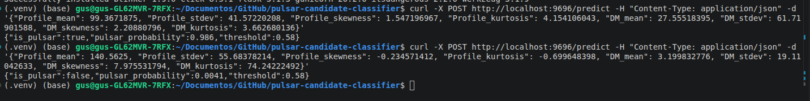

# Pulsar Candidate Classifier

Machine learning model that classifies radio-signal candidates as real pulsars or noise, using the HTRU2 dataset. The model is served as a web service and packaged in a Docker container.

## Problem description

Pulsars are rapidly rotating neutron stars that emit radio beams. Radio telescopes record huge numbers of candidate signals, and almost all of them are noise or radio-frequency interference: only about 9% of the candidates in this dataset are real pulsars. Checking each candidate by hand is slow, so a model can rank candidates and send only the likely pulsars to human review.

Each candidate is described by 8 numeric statistics: 4 from the integrated pulse profile (`Profile_*`) and 4 from the DM-SNR curve (`DM_*`): mean, standard deviation, skewness and kurtosis of each.

**How the model would be used:** it scores each candidate with a probability, and candidates above a threshold are reviewed by a person. Missing a real pulsar is worse than reviewing an extra false alarm, so the decision threshold is chosen to keep recall at about 90%.

## Data

- **Source:** [HTRU2, UCI Machine Learning Repository](https://archive.ics.uci.edu/dataset/372/htru2) (17,898 candidates, 1,639 pulsars, 16,259 non-pulsars).
- The CSV is included in the repository (`data/htru2.csv`). To download it again: `python data/download_data.py`.

## Results

All choices (models, hyperparameters, threshold) were made with cross-validation on the training split (80%). The test split (20%, 3,580 candidates, 328 pulsars) was used once at the end.

**Cross-validation (5-fold, PR-AUC, mean ± std).** A baseline that always predicts "not a pulsar" gets PR-AUC 0.0916 (the pulsar rate).

| Model | Default parameters | Tuned |
|---|---|---|
| Logistic regression | 0.9229 | 0.9240 ± 0.0133 |
| Random forest | 0.9232 | 0.9296 ± 0.0126 |
| XGBoost | 0.9202 | 0.9307 ± 0.0105 |

The differences between models are smaller than the variation between folds, so the three models perform about the same. XGBoost was selected as the best nominal model.

**Decision threshold:** 0.58, the highest-precision threshold with recall >= 0.90 on cross-validated predictions (precision 0.835, recall 0.900).

**Test set (evaluated once, threshold 0.58):**

| PR-AUC | ROC-AUC | Precision | Recall | F1 |
|---|---|---|---|---|
| 0.931 | 0.976 | 0.816 | 0.909 | 0.860 |

Confusion matrix: 3185 true negatives, 67 false positives, 30 false negatives, 298 true positives. Accuracy (97.3%) is misleading because always predicting "noise" would score 90.8%.

**Limitations:** the test set has only 328 pulsars, so metrics have a margin of a few points. Hyperparameters were searched on a limited grid, and some best values are on its edge. The dataset is clean (no missing values) and comes from one survey, so performance on other telescopes is unknown.

## Project structure

```
pulsar-candidate-classifier/
├── data/
│   ├── htru2.csv              # dataset
│   └── download_data.py       # downloads the dataset from UCI
├── docs/
│   └── service_demo.png       # service running and answering requests
├── notebook.ipynb             # data checks, EDA, feature importance, model selection
├── train.py                   # trains the final model and saves model.pkl
├── predict.py                 # Flask web service
├── model.pkl                  # trained model, threshold and feature names
├── requirements.txt           # dependencies for the notebook and scripts
├── requirements-docker.txt    # dependencies for the container
├── Dockerfile
└── README.md
```

## How to run

Tested with Python 3.13 on Linux.

### 1. Environment

```bash
git clone https://github.com/Gus-IA/pulsar-candidate-classifier.git
cd pulsar-candidate-classifier
python3 -m venv .venv
source .venv/bin/activate        # on Windows: .venv\Scripts\activate
pip install -r requirements.txt
```

### 2. Notebook (EDA and model selection)

```bash
jupyter notebook notebook.ipynb
```

### 3. Train the final model

```bash
python train.py
```

This reproduces the train/test split, trains XGBoost with the best parameters found in the notebook, prints test metrics and saves `model.pkl`. The pickle should be loaded with the same library versions listed in the requirements files, so run `train.py` again if you use different versions.

### 4. Run the web service locally

```bash
python predict.py
```

### 5. Run with Docker

```bash
docker build -t pulsar-classifier .
docker run -p 9696:9696 pulsar-classifier
```

### 6. Send a request

```bash
curl -X POST http://localhost:9696/predict \
  -H "Content-Type: application/json" \
  -d '{"Profile_mean": 99.3671875, "Profile_stdev": 41.57220208, "Profile_skewness": 1.547196967, "Profile_kurtosis": 4.154106043, "DM_mean": 27.55518395, "DM_stdev": 61.71901588, "DM_skewness": 2.20880796, "DM_kurtosis": 3.662680136}'
```

Response:

```json
{"is_pulsar": true, "pulsar_probability": 0.986, "threshold": 0.58}
```

Other endpoints: `GET /health` returns `{"status": "ok"}` and `GET /` describes the service.

